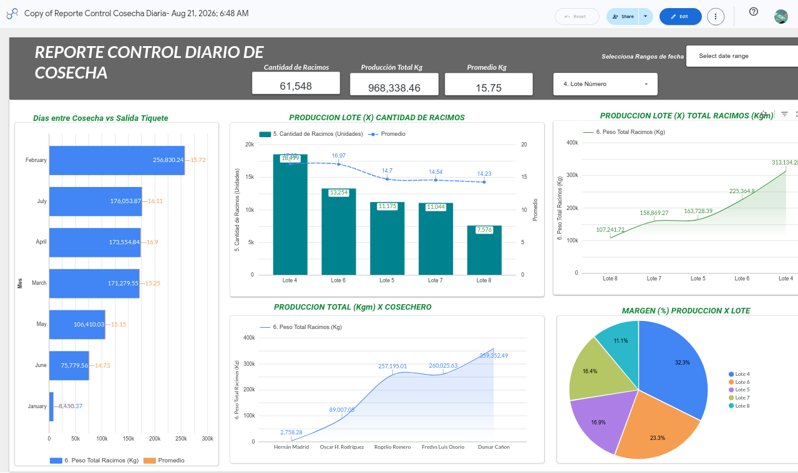

# Juan Carlos Carvajal G.
### Oficial de Cumplimiento | Profesional en Finanzas y Negocios Internacionales 

Adapto datos financieros, Tributarios y  normativos en estrategias claras y accionables. Más de 10 años de experiencia diseñando sistemas de control de riesgo (SARLAFT/SAGRILAFT) y creando modelos visuales de dashboards interactivos que optimizan la toma de decisiones en finanzas, impuestos y logística.

---

## 💼 Sobre Mí

Soy un profesional en Finanzas y Negocios Internacionales con una trayectoria sólida en los sectores administrativo, de compras, logística, transporte y servicios contables y financieros. Mi diferencial es combinar el rigor normativo (prevención de LA/FT, control interno) con herramientas analíticas modernas como Power BI, Google Looker Studio y Excel avanzado. Me especializo en detectar riesgos a tiempo y convertir hojas de cálculo complejas en tableros de control claros para la toma de decisiones estratégicas.
---

## 🚀 Servicios de Consultoría
Ofrezco soluciones prácticas para empresas que necesitan ordenar sus procesos y visualizar su informacion operativa, administrativa y contable:

- 🛡️ **Implementación y Auditoría SARLAFT/SAGRILAFT:** Diseño de matrices de riesgo, manuales de prevención LA/FT y capacitación a equipos.
- 📊 **Dashboards Financieros y Tributarios:** Creación de tableros interactivos (Power BI / Looker Studio) para el seguimiento de impuestos (Régimen Simple), flujo de caja y KPIs operativos.
- 📈 **Análisis de Costos e Inventarios:** Estructuración de bases de datos, reestructuración de deuda y modelos financieros para la optimización de recursos.

---
## 📊 Portafolio de Dashboards

### Reporte Control Diario de Cosecha
*Herramienta:* Google Looker Studio  
*Descripción:* Tablero interactivo para el seguimiento de producción agrícola por lotes, análisis de eficiencia de cosecheros y métricas operativas en tiempo real. Permite la toma de decisiones basada en datos concretos de producción.

[Ver reporte interactivo en Looker Studio](https://datastudio.google.com/u/0/reporting/0408244f-fa7c-4399-8528-1aa5f06cb63b/page/page_12345)
## 📂 Experiencia Destacada

- **Coordinador Administrativo** | Word Service Jacome SAS (2021 - Actual)  
  Gestión tributaria (Régimen Simple), análisis de balances y automatización de reportes financieros con Excel avanzado.
- **Analista de Costos e Inventarios** | Lass Comercializadora SAS (2019 - 2020)  
  Diseño e implementación del área de análisis de costos y modelos financieros.
- **Director Administrativo (Freelance)** | Cootraupar / Transcacique / Cootranscolser (2015 - 2018)  
  Reestructuración de deuda, diseño de bases de información e implementación de Indicadores de Gestión (KPIs) para sistemas de transporte masivo.

---

## 📬 Contacto
¿Listo para optimizar el control y la visualización de datos en su empresa? Hablemos.

- 📧 **Correo:** juancarlos.carvajal.pro@gmail.com
- 📱 **Teléfono / WhatsApp:** +57 313 388 54 05 - 323 798 4171
- 🔗 **LinkedIn:** linkedin.com/in/juancarloscarvajal19
